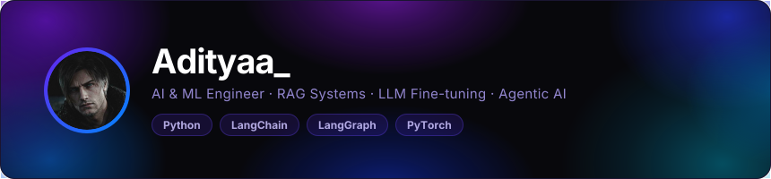

<h2 align="center">AI systems, measured.</h2>

Applied AI / Prompt Engineering intern · B.Tech IT, MAIT (GGSIPU), 2023–27

<strong>I benchmark, not just build.</strong>

<h2 align="center">About me</h2>

I build and evaluate RAG systems, agent workflows, and CLI-native agent skills. My current focus is agentic orchestration and self-hosted LLM inference with vLLM.

I care about measured trade-offs: answer quality, hallucination, latency, cost, and safety. The experiments below are linked to their repositories, not invented dashboard numbers.

Oracle Generative AI Professional · Oracle AI Vector Search Professional

<h2 align="center">Connect</h2>

  <a href="https://github.com/Adityax-07?tab=repositories">GitHub projects</a> &nbsp;·&nbsp;
  <a href="https://www.linkedin.com/in/aditya-bisht-82211b327/">LinkedIn</a> &nbsp;·&nbsp;
  <a href="mailto:aaditya85677@gmail.com">Email</a>

<h2 align="center">Tech stack</h2>

<strong>Languages &amp; app development</strong> Python · TypeScript · JavaScript · FastAPI · Streamlit

  

<strong>AI &amp; inference</strong> PyTorch · TensorFlow · scikit-learn · Hugging Face · LangChain · LangGraph · FAISS · vLLM

  

<strong>Tools</strong> Docker · Git · GitHub · VS Code

  

<h2 align="center">Selected work</h2>

* [RAG-Systems-eval-suite](https://github.com/Adityax-07/RAG-Systems-eval-suite) — 8 RAG systems, 50 questions, 10 metrics; advanced RAG scored 0.770 overall.
* [AgentBench](https://github.com/Adityax-07/AgentBench) — 50-query evaluation; 4% hallucination for the multi-agent system versus 24% for a single agent.
* [LLM-vs-RAG-vs-Fine-Tuning-](https://github.com/Adityax-07/LLM-vs-RAG-vs-Fine-Tuning-) — compared 3 systems across 50 questions and 8 metrics.
* [RAG_SECURITY_DEMO](https://github.com/Adityax-07/RAG_SECURITY_DEMO) — secure RAG pipeline tested with 100 labeled queries across 8 categories.

<h2 align="center">GitHub stats</h2>

  

<h2 align="center">Contribution trail</h2>

  <picture>
    <source media="(prefers-color-scheme: dark)" srcset="https://raw.githubusercontent.com/Adityax-07/Adityax-07/output/pacman-contribution-graph-dark.svg" />
    <source media="(prefers-color-scheme: light)" srcset="https://raw.githubusercontent.com/Adityax-07/Adityax-07/output/pacman-contribution-graph.svg" />
    
  </picture>

<h2 align="center">Philosophy</h2>

<em>Build the system. Measure the result. Publish the trade-off.</em>

