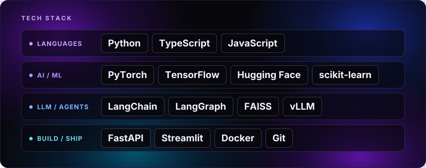

## Proof of work

I benchmark, not just build.

* [RAG-Systems-eval-suite](https://github.com/Adityax-07/RAG-Systems-eval-suite) — 8 RAG systems evaluated on 50 questions and 10 metrics; advanced RAG scored 0.770 overall.
* [AgentBench](https://github.com/Adityax-07/AgentBench) — 50-query evaluation measured 4% hallucination for the multi-agent system versus 24% for a single agent.
* [LLM-vs-RAG-vs-Fine-Tuning-](https://github.com/Adityax-07/LLM-vs-RAG-vs-Fine-Tuning-) — compared 3 systems across 50 questions and 8 metrics.
* [RAG_SECURITY_DEMO](https://github.com/Adityax-07/RAG_SECURITY_DEMO) — tested a secure RAG pipeline with 100 labeled queries across 8 categories.

## Currently

* Building CLI-native agent skills and repeatable orchestration.
* Learning vLLM serving and self-hosted inference.
* Benchmarking RAG and agent trade-offs across accuracy, latency, cost, and safety.

## Background

B.Tech IT at MAIT, GGSIPU (2023–27) · Applied AI / Prompt Engineering intern 
Oracle Generative AI Professional · Oracle AI Vector Search Professional

[Projects](https://github.com/Adityax-07?tab=repositories) · [LinkedIn](https://www.linkedin.com/in/aditya-bisht-82211b327/) · [Email](mailto:aaditya85677@gmail.com)
