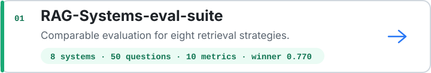
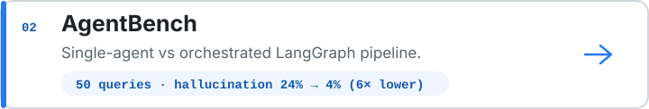
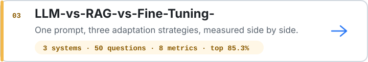
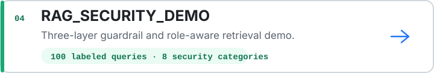
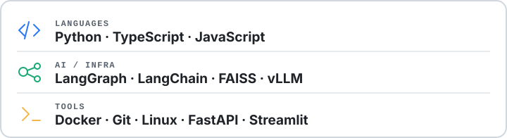
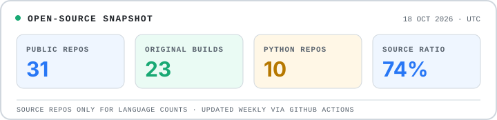

<picture>
  <source media="(prefers-color-scheme: dark)" srcset="./assets/hero-dark.svg">
  <source media="(prefers-color-scheme: light), (prefers-color-scheme: no-preference)" srcset="./assets/hero-light.svg">
  
</picture>

### Applied AI engineer in training — building agent systems that can be measured.

B.Tech IT @ MAIT, GGSIPU · 2023–27 
Applied AI / Prompt Engineering intern 
Focused on CLI-native agent skills, agentic orchestration, and self-hosted LLM inference with vLLM

`Oracle Generative AI Professional` · `Oracle AI Vector Search Professional`

## Currently

`BUILDING` — CLI-native skills and repeatable agent orchestration 
`LEARNING` — vLLM serving, evaluation design, and self-hosted inference 
`BENCHMARKING` — RAG and agent trade-offs across accuracy, latency, cost, and safety

## Proof of work

<a href="https://github.com/Adityax-07/RAG-Systems-eval-suite">
  <picture>
    <source media="(prefers-color-scheme: dark)" srcset="./assets/work-rag-eval-dark.svg">
    <source media="(prefers-color-scheme: light), (prefers-color-scheme: no-preference)" srcset="./assets/work-rag-eval-light.svg">
    
  </picture>
</a>

<a href="https://github.com/Adityax-07/AgentBench">
  <picture>
    <source media="(prefers-color-scheme: dark)" srcset="./assets/work-agentbench-dark.svg">
    <source media="(prefers-color-scheme: light), (prefers-color-scheme: no-preference)" srcset="./assets/work-agentbench-light.svg">
    
  </picture>
</a>

<a href="https://github.com/Adityax-07/LLM-vs-RAG-vs-Fine-Tuning-">
  <picture>
    <source media="(prefers-color-scheme: dark)" srcset="./assets/work-codesage-dark.svg">
    <source media="(prefers-color-scheme: light), (prefers-color-scheme: no-preference)" srcset="./assets/work-codesage-light.svg">
    
  </picture>
</a>

<a href="https://github.com/Adityax-07/RAG_SECURITY_DEMO">
  <picture>
    <source media="(prefers-color-scheme: dark)" srcset="./assets/work-rag-security-dark.svg">
    <source media="(prefers-color-scheme: light), (prefers-color-scheme: no-preference)" srcset="./assets/work-rag-security-light.svg">
    
  </picture>
</a>

## Stack

<picture>
  <source media="(prefers-color-scheme: dark)" srcset="./assets/stack-dark.svg">
  <source media="(prefers-color-scheme: light), (prefers-color-scheme: no-preference)" srcset="./assets/stack-light.svg">
  
</picture>

## Open-source snapshot

<picture>
  <source media="(prefers-color-scheme: dark)" srcset="./assets/stats-dark.svg">
  <source media="(prefers-color-scheme: light), (prefers-color-scheme: no-preference)" srcset="./assets/stats-light.svg">
  
</picture>

Generated weekly from the GitHub API by a repository-owned workflow. Forks are excluded from source-build and language counts.

## Contact

[Project portfolio](https://github.com/Adityax-07?tab=repositories) · [LinkedIn](https://www.linkedin.com/in/aditya-bisht-82211b327/) · [Email](mailto:aaditya85677@gmail.com)
