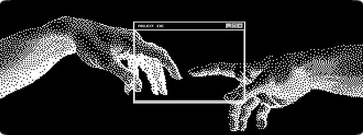
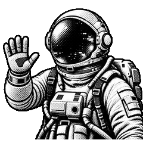

<p align="center"></p>

```aura width=860 height=200
<div style={{
  width: '100%', height: '100%', background: '#08090b',
  display: 'flex', alignItems: 'center', fontFamily: 'Inter',
  position: 'relative', overflow: 'hidden', borderRadius: 16,
  border: '1px solid rgba(230,230,230,0.20)'
}}>
  <style>{`
    @keyframes orb-a {
      0%   { transform:translate(0px,0px);   opacity:0.75; }
      25%  { transform:translate(110px,55px); opacity:1.0;  }
      50%  { transform:translate(65px,110px); opacity:0.82; }
      75%  { transform:translate(-25px,65px); opacity:0.95; }
      100% { transform:translate(0px,0px);   opacity:0.75; }
    }
    @keyframes orb-b {
      0%   { transform:translate(0px,0px);    opacity:0.70; }
      25%  { transform:translate(-100px,50px); opacity:0.92; }
      50%  { transform:translate(-55px,105px); opacity:0.78; }
      75%  { transform:translate(20px,60px);  opacity:1.0;  }
      100% { transform:translate(0px,0px);    opacity:0.70; }
    }
    @keyframes orb-c {
      0%   { transform:translate(0px,0px);   opacity:0.68; }
      30%  { transform:translate(50px,95px);  opacity:0.90; }
      65%  { transform:translate(-45px,75px); opacity:0.95; }
      100% { transform:translate(0px,0px);   opacity:0.68; }
    }
    @keyframes orb-d {
      0%   { transform:translate(0px,0px);   opacity:0.72; }
      35%  { transform:translate(90px,35px);  opacity:0.95; }
      70%  { transform:translate(55px,-40px); opacity:0.80; }
      100% { transform:translate(0px,0px);   opacity:0.72; }
    }
    #glow-1 { animation: orb-a 9s  ease-in-out infinite; }
    #glow-2 { animation: orb-b 11s ease-in-out infinite; }
    #glow-3 { animation: orb-b 10s ease-in-out infinite reverse; }
    #glow-4 { animation: orb-a 12s ease-in-out infinite reverse; }
    #glow-5 { animation: orb-c 8s  ease-in-out infinite; }
    #glow-6 { animation: orb-c 13s ease-in-out infinite reverse; }
    #glow-7 { animation: orb-d 14s ease-in-out infinite; }
    #glow-8 { animation: orb-d 10s ease-in-out infinite reverse; }
  `}</style>

  <svg width="860" height="200" style={{ position: 'absolute', top: 0, left: 0 }}>
    <defs>
      <radialGradient id="g1" cx="50%" cy="50%" r="50%">
        <stop offset="0%" stopColor="rgba(255,255,255,0.65)" />
        <stop offset="22%" stopColor="rgba(255,255,255,0.43)" />
        <stop offset="50%" stopColor="rgba(255,255,255,0.18)" />
        <stop offset="78%" stopColor="rgba(255,255,255,0.04)" />
        <stop offset="100%" stopColor="rgba(255,255,255,0)" />
      </radialGradient>
      <radialGradient id="g2" cx="50%" cy="50%" r="50%">
        <stop offset="0%" stopColor="rgba(255,255,255,0.60)" />
        <stop offset="24%" stopColor="rgba(255,255,255,0.38)" />
        <stop offset="52%" stopColor="rgba(255,255,255,0.15)" />
        <stop offset="80%" stopColor="rgba(255,255,255,0.03)" />
        <stop offset="100%" stopColor="rgba(255,255,255,0)" />
      </radialGradient>
      <radialGradient id="g3" cx="50%" cy="50%" r="50%">
        <stop offset="0%" stopColor="rgba(255,255,255,0.44)" />
        <stop offset="24%" stopColor="rgba(255,255,255,0.26)" />
        <stop offset="54%" stopColor="rgba(255,255,255,0.10)" />
        <stop offset="82%" stopColor="rgba(255,255,255,0.02)" />
        <stop offset="100%" stopColor="rgba(255,255,255,0)" />
      </radialGradient>
      <radialGradient id="g4" cx="50%" cy="50%" r="50%">
        <stop offset="0%" stopColor="rgba(255,255,255,0.42)" />
        <stop offset="24%" stopColor="rgba(255,255,255,0.24)" />
        <stop offset="54%" stopColor="rgba(255,255,255,0.09)" />
        <stop offset="82%" stopColor="rgba(255,255,255,0.02)" />
        <stop offset="100%" stopColor="rgba(255,255,255,0)" />
      </radialGradient>
      <radialGradient id="g5" cx="50%" cy="50%" r="50%">
        <stop offset="0%" stopColor="rgba(255,255,255,0.48)" />
        <stop offset="24%" stopColor="rgba(255,255,255,0.28)" />
        <stop offset="54%" stopColor="rgba(255,255,255,0.11)" />
        <stop offset="82%" stopColor="rgba(255,255,255,0.02)" />
        <stop offset="100%" stopColor="rgba(255,255,255,0)" />
      </radialGradient>
      <radialGradient id="g6" cx="50%" cy="50%" r="50%">
        <stop offset="0%" stopColor="rgba(255,255,255,0.38)" />
        <stop offset="24%" stopColor="rgba(255,255,255,0.22)" />
        <stop offset="54%" stopColor="rgba(255,255,255,0.08)" />
        <stop offset="82%" stopColor="rgba(255,255,255,0.02)" />
        <stop offset="100%" stopColor="rgba(255,255,255,0)" />
      </radialGradient>
      <radialGradient id="g7" cx="50%" cy="50%" r="50%">
        <stop offset="0%" stopColor="rgba(255,255,255,0.38)" />
        <stop offset="24%" stopColor="rgba(255,255,255,0.22)" />
        <stop offset="54%" stopColor="rgba(255,255,255,0.08)" />
        <stop offset="82%" stopColor="rgba(255,255,255,0.02)" />
        <stop offset="100%" stopColor="rgba(255,255,255,0)" />
      </radialGradient>
      <radialGradient id="g8" cx="50%" cy="50%" r="50%">
        <stop offset="0%" stopColor="rgba(255,255,255,0.40)" />
        <stop offset="24%" stopColor="rgba(255,255,255,0.24)" />
        <stop offset="54%" stopColor="rgba(255,255,255,0.09)" />
        <stop offset="82%" stopColor="rgba(255,255,255,0.02)" />
        <stop offset="100%" stopColor="rgba(255,255,255,0)" />
      </radialGradient>
    </defs>
    <ellipse id="glow-1" cx="50"  cy="22"  rx="200" ry="150" fill="url(#g1)" />
    <ellipse id="glow-2" cx="810" cy="18"  rx="190" ry="148" fill="url(#g2)" />
    <ellipse id="glow-3" cx="55"  cy="178" rx="185" ry="140" fill="url(#g3)" />
    <ellipse id="glow-4" cx="805" cy="182" rx="180" ry="138" fill="url(#g4)" />
    <ellipse id="glow-5" cx="430" cy="-8"  rx="230" ry="130" fill="url(#g5)" />
    <ellipse id="glow-6" cx="430" cy="208" rx="240" ry="132" fill="url(#g6)" />
    <ellipse id="glow-7" cx="-12" cy="100" rx="155" ry="118" fill="url(#g7)" />
    <ellipse id="glow-8" cx="872" cy="100" rx="155" ry="118" fill="url(#g8)" />
  </svg>

  <div style={{
    position: 'absolute', left: 48, top: 52, width: 96, height: 96,
    borderRadius: 48, background: 'linear-gradient(135deg, #f2f2f2, #6b6b6b)',
    display: 'flex', alignItems: 'center', justifyContent: 'center',
  }}>
    
  </div>

  <div style={{ display: 'flex', flexDirection: 'column', marginLeft: 168, gap: 8 }}>
    <div style={{ display: 'flex', fontSize: 38, fontWeight: 800, color: '#ffffff', letterSpacing: '-1px', lineHeight: 1 }}>
      {github.user.name || github.user.login || 'Aditya Bisht'}
    </div>
    <div style={{ display: 'flex', fontSize: 15, color: 'rgba(220,220,220,0.82)', fontWeight: 400, letterSpacing: '0.3px' }}>
      {github.user.bio || 'AI & ML Engineer · RAG Systems · LLM Fine-tuning · Agentic AI'}
    </div>
    <div style={{ display: 'flex', gap: 8, marginTop: 6 }}>
      {['Python', 'LangChain', 'LangGraph', 'PyTorch'].map(function(tag) {
        return (
          <div key={tag} style={{
            display: 'flex', paddingTop: 4, paddingBottom: 4, paddingLeft: 12, paddingRight: 12, borderRadius: 20,
            background: 'rgba(255,255,255,0.07)', border: '1px solid rgba(230,230,230,0.22)',
            color: 'rgba(232,232,232,0.90)', fontSize: 12, fontWeight: 600,
          }}>{tag}</div>
        );
      })}
    </div>
  </div>
</div>
```

<h2 align="center">AI systems, measured.</h2>

<p align="center">Applied AI / Prompt Engineering intern · B.Tech IT, MAIT (GGSIPU), 2023–27</p>

<p align="center"><strong>I benchmark, not just build.</strong></p>

<h2 align="center">About me</h2>



I build and evaluate RAG systems, agent workflows, and CLI-native agent skills. My current focus is agentic orchestration and self-hosted LLM inference with vLLM.

I care about measured trade-offs: answer quality, hallucination, latency, cost, and safety. The experiments below are linked to their repositories, not invented dashboard numbers.

Oracle Generative AI Professional · Oracle AI Vector Search Professional

<br clear="right" />

<h2 align="center">Connect</h2>

<p align="center">
  <a href="https://github.com/Adityax-07?tab=repositories">GitHub projects</a> &nbsp;·&nbsp;
  <a href="https://www.linkedin.com/in/aditya-bisht-82211b327/">LinkedIn</a> &nbsp;·&nbsp;
  <a href="mailto:aaditya85677@gmail.com">Email</a>
</p>

<h2 align="center">Tech stack</h2>

<p align="center"><strong>Languages &amp; app development</strong><br />Python · TypeScript · JavaScript · FastAPI · Streamlit</p>

<p align="center">
  
  
</p>

<p align="center"><strong>AI &amp; inference</strong><br />PyTorch · TensorFlow · scikit-learn · Hugging Face · LangChain · LangGraph · FAISS · vLLM</p>

<p align="center">
  
  <br />
  
</p>

<p align="center"><strong>Tools</strong><br />Docker · Git · GitHub · VS Code</p>

<p align="center">
  
</p>

<h2 align="center">Selected work</h2>

- [RAG-Systems-eval-suite](https://github.com/Adityax-07/RAG-Systems-eval-suite) — 8 RAG systems, 50 questions, 10 metrics; advanced RAG scored 0.770 overall.
- [AgentBench](https://github.com/Adityax-07/AgentBench) — 50-query evaluation; 4% hallucination for the multi-agent system versus 24% for a single agent.
- [LLM-vs-RAG-vs-Fine-Tuning-](https://github.com/Adityax-07/LLM-vs-RAG-vs-Fine-Tuning-) — compared 3 systems across 50 questions and 8 metrics.
- [RAG_SECURITY_DEMO](https://github.com/Adityax-07/RAG_SECURITY_DEMO) — secure RAG pipeline tested with 100 labeled queries across 8 categories.

<h2 align="center">GitHub stats</h2>

<p align="center">
  
</p>

<h2 align="center">Contribution trail</h2>

<p align="center">
  <picture>
    <source media="(prefers-color-scheme: dark)" srcset="https://raw.githubusercontent.com/Adityax-07/Adityax-07/output/pacman-contribution-graph-dark.svg" />
    <source media="(prefers-color-scheme: light)" srcset="https://raw.githubusercontent.com/Adityax-07/Adityax-07/output/pacman-contribution-graph.svg" />
    
  </picture>
</p>

<h2 align="center">Philosophy</h2>

<p align="center"><em>Build the system. Measure the result. Publish the trade-off.</em></p>
